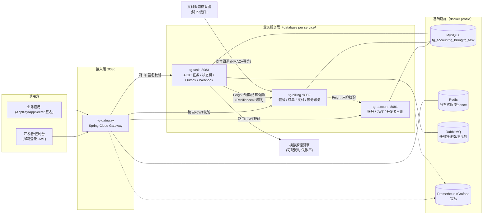
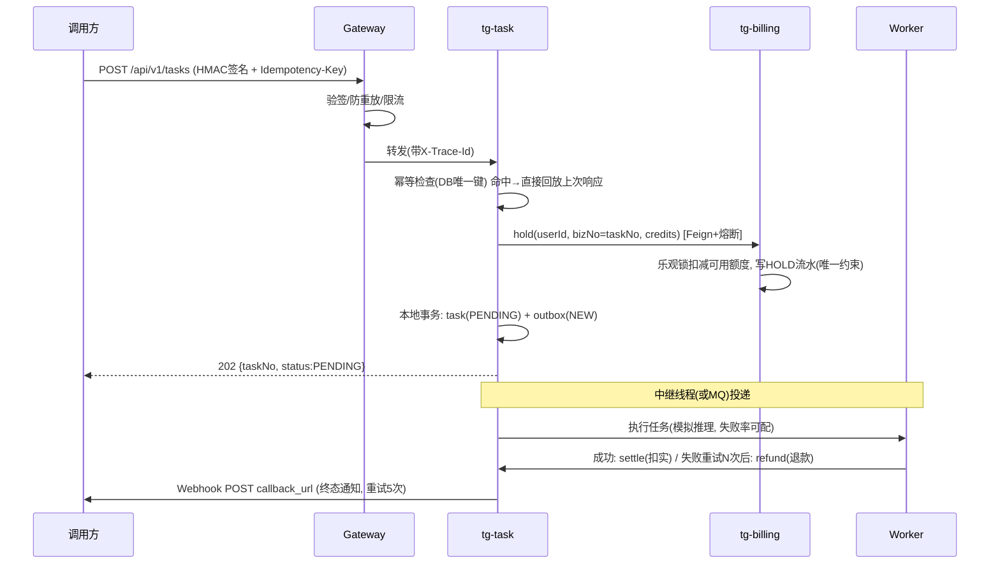
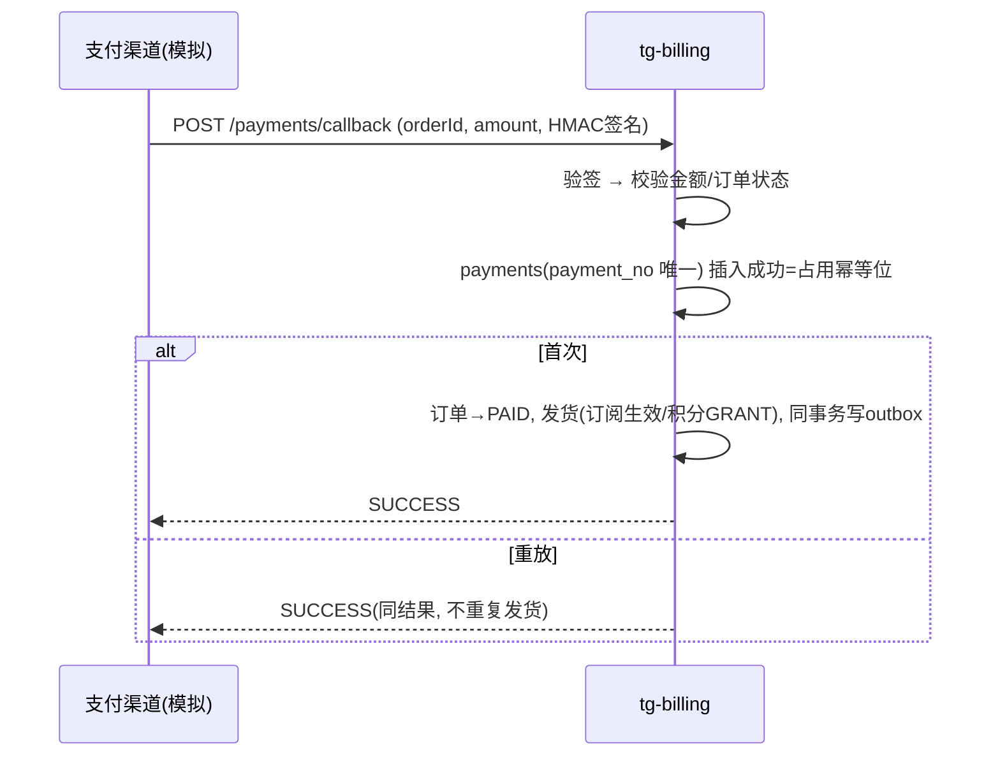

# 天工 TianGong · 系统架构设计

文档版本：v1.0（2026-10-18）

## 1. 总体架构

## 2. 服务职责与边界

| 服务 | 端口 | 职责 | 不负责 |
| --- | --- | --- | --- |
| tg-gateway | 8080 | 路由、JWT/AppKey 认证、防重放、限流、熔断降级、traceId 注入 | 业务逻辑 |
| tg-account | 8081 | 用户注册/认证/令牌、开发者应用与密钥管理 | 积分、任务 |
| tg-billing | 8082 | 商品/订单/支付回调、订阅生命周期、积分账务（预扣/结算/退款） | 任务执行 |
| tg-task | 8083 | 任务提交与状态机、异步执行、Outbox 可靠投递、Webhook 通知、超时治理 | 扣费规则 |

**服务间通信**：同步用 OpenFeign（预扣/结算/退款、用户校验），异步用消息（Outbox → MQ → Worker，本地 profile 下走进程内派发器，接口一致）。网关与业务服务之间无直接 DB 共享，**每个服务独占自己的 schema**（database per service），跨服务数据只通过 API 获取——这是微服务最重要的边界纪律。

## 3. 关键技术选型与理由

| 维度 | 选型 | 理由（含备选） |
| --- | --- | --- |
| 语言/框架 | Java 17 + Spring Boot 3.5 + Spring Cloud 2025 | 企业主流 LTS；Gateway/OpenFeign/CircuitBreaker 生态完整。备选：Go（常见于高并发网关/中间件场景，本项目以 Spring 生态为准） |
| 服务发现 | **静态地址 + 配置化 URL**（本期） | 单机/Compose 部署最稳；备选 Nacos（生产 K8s 下用 Service DNS + LB，见 08 路线图） |
| ORM | Spring Data JPA + 乐观锁（version 字段） | 领域模型优先、迁移少；账务关键路径手写 `@Lock(PESSIMISTIC_WRITE)` 或乐观重试。备选 MyBatis-Plus（文档注明等价改写方式，面试常问） |
| 认证 | jjwt (HS256, 可配密钥) + RefreshToken 轮换 | 简单可靠；生产建议非对称 RS256 + JWKS 让网关免共享密钥 |
| 开放 API 认证 | AppKey + HMAC-SHA256 签名（时间戳+nonce+body 摘要） | 对标主流开放平台（阿里云等），防篡改+防重放 |
| 幂等 | `Idempotency-Key` + DB 唯一约束 + 响应快照回放 | 以数据库为准绳，Redis 不可靠场景下仍正确 |
| 可靠消息 | **本地消息表（Outbox）** + 定时中继 | 业务落库与消息发送同事务，杜绝"半消息"；MQ 不可用时中继退避重试 |
| MQ | RabbitMQ（docker profile）/ 进程内派发器（local profile） | 同一套 `TaskDispatcher` 接口双实现，笔记本零依赖可跑，Compose 下走真实 MQ |
| 限流 | 网关令牌桶：Redis（分布式）/ ConcurrentHashMap（单机） | 令牌桶允许突发、语义清晰 |
| 熔断 | Resilience4j（Feign 集成） | 资金操作只快速失败不降级伪造；查询类可降级缓存 |
| 数据库迁移 | Flyway，服务内各自维护 | 版本化、可重复执行 |
| 文档 | springdoc-openapi（Swagger UI） | 验收即用 |
| 可观测 | Micrometer + Prometheus + 结构化日志(traceId) | 生产标准；OTel 列入路线图 |

## 4. 关键时序

### 4.1 任务提交（幂等 + 预扣 + Outbox）

### 4.2 支付回调（渠道重复通知幂等发货）

## 5. 部署形态

| 形态 | 用途 | 组成 |
| --- | --- | --- |
| `local` profile | 开发/验收（零外部依赖） | H2 文件库 + 进程内 MQ/限流，`scripts/dev-up.sh` 一键拉起 4 个进程 |
| `docker` profile | 类生产 | MySQL/Redis/RabbitMQ/Prometheus/Grafana + 服务容器，`docker compose up` |

配置一律外置（application-{profile}.yml + 环境变量覆盖），密钥类（JWT secret、HMAC key、AES key、internal token）支持环境变量注入，默认值仅用于本地开发。

## 6. 容量与性能预估（单机验收基线）

- 任务提交链路：网关(~1ms) + 幂等查询(1次索引读) + Feign预扣(1次乐观锁写) + 落库(2写1事务) ≈ P99 < 300ms；
- Worker 吞吐：默认并发 8、单任务 2~6s 模拟推理 ⇒ ~2 任务/秒；可通过配置扩展到 RabbitMQ 多消费者横向扩容；
- 积分账务：乐观锁冲突时应用层重试 3 次，冲突概率在单账户 <5% 时可忽略。

## 7. 架构决策记录（ADR 摘要）

| # | 决策 | 备选 | 取舍 |
| --- | --- | --- | --- |
| ADR-1 | AccessToken 短时效 + 不做网关黑名单 | Redis 黑名单 | 登出后最长 30min 残留风险，换取网关无状态、免 Redis 依赖；RefreshToken 即时撤销已收敛风险。生产高敏感场景可加黑名单 |
| ADR-2 | 积分预扣在 billing 服务集中管理 | task 本地记账 | 账务单一服务收敛，接口幂等（bizNo）保证跨服务一致 |
| ADR-3 | Outbox 而非事务消息 | RocketMQ 事务消息 | 不绑定特定 MQ；中继实现 ~100 行，面试可讲清最终一致 |
| ADR-4 | local profile 进程内 MQ/限流 | 强制依赖 Docker | 验收零门槛；接口抽象保证 docker profile 行为一致 |
| ADR-5 | JPA + 乐观锁 | MyBatis-Plus | 领域模型内聚；账务热点路径用显式 `@Transactional` + version 重试 |
