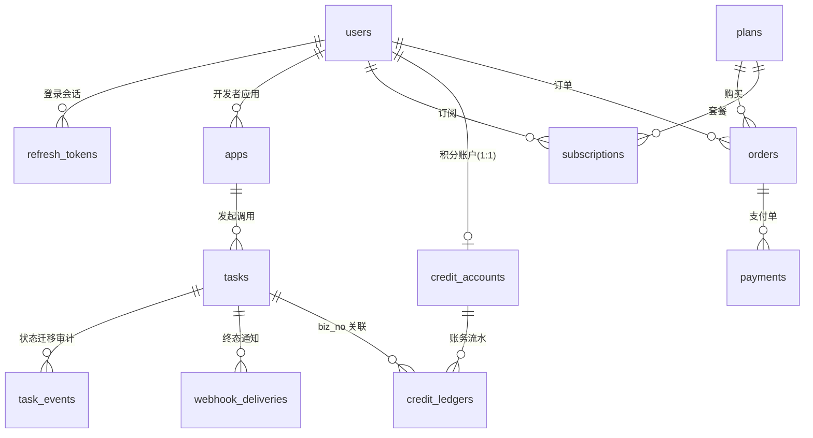

# 天工 TianGong · 数据库设计

文档版本：v1.0（2026-10-18）。三个服务各自独占 schema：`tg_account` / `tg_billing` / `tg_task`。DDL 由 Flyway 管理（`src/main/resources/db/migration/`），以下为核心表与约束设计（以 MySQL 为准，H2 兼容方言自动适配）。

## 1. ER 总览



## 2. tg_account

### users
```sql
CREATE TABLE users (
  id            BIGINT AUTO_INCREMENT PRIMARY KEY,
  email         VARCHAR(128)  NOT NULL,
  password_hash VARCHAR(100)  NOT NULL,          -- BCrypt
  nickname      VARCHAR(64)   NOT NULL,
  status        VARCHAR(16)   NOT NULL DEFAULT 'ACTIVE',  -- ACTIVE/DISABLED
  version       BIGINT        NOT NULL DEFAULT 0,
  created_at    DATETIME(6)   NOT NULL DEFAULT CURRENT_TIMESTAMP(6),
  updated_at    DATETIME(6)   NOT NULL DEFAULT CURRENT_TIMESTAMP(6) ON UPDATE CURRENT_TIMESTAMP(6),
  UNIQUE KEY uk_users_email (email)
) ENGINE=InnoDB;
```

### refresh_tokens（轮换 + 家族撤销）
```sql
CREATE TABLE refresh_tokens (
  id          BIGINT AUTO_INCREMENT PRIMARY KEY,
  user_id     BIGINT       NOT NULL,
  token_hash  VARCHAR(64)     NOT NULL,             -- SHA-256(token)
  family_id   BIGINT       NOT NULL,             -- 同一登录链路
  status      VARCHAR(16)  NOT NULL DEFAULT 'ACTIVE', -- ACTIVE/USED/REVOKED
  expires_at  DATETIME(6)  NOT NULL,
  created_at  DATETIME(6)  NOT NULL DEFAULT CURRENT_TIMESTAMP(6),
  UNIQUE KEY uk_rt_hash (token_hash),
  KEY idx_rt_user (user_id)
) ENGINE=InnoDB;
```

### apps（开发者应用）
```sql
CREATE TABLE apps (
  id             BIGINT AUTO_INCREMENT PRIMARY KEY,
  user_id        BIGINT      NOT NULL,
  app_key        VARCHAR(32) NOT NULL,           -- 形如 ak_xxxxxxxx
  secret_cipher  VARBINARY(256) NOT NULL,        -- AES-GCM(AppSecret, masterKey)
  name           VARCHAR(64) NOT NULL,
  callback_url   VARCHAR(512),
  status         VARCHAR(16) NOT NULL DEFAULT 'ACTIVE',
  rate_limit_per_min INT NOT NULL DEFAULT 120,
  created_at     DATETIME(6) NOT NULL DEFAULT CURRENT_TIMESTAMP(6),
  UNIQUE KEY uk_apps_key (app_key),
  KEY idx_apps_user (user_id)
) ENGINE=InnoDB;
```
> 明文 Secret 只在「创建/重置」响应里出现一次；库中仅密文。网关验签时解密重算 HMAC。

## 3. tg_billing

### plans（商品：订阅 / 积分包）
```sql
CREATE TABLE plans (
  id            BIGINT AUTO_INCREMENT PRIMARY KEY,
  code          VARCHAR(32)  NOT NULL,           -- starter_pro / credits_500
  name          VARCHAR(64)  NOT NULL,
  type          VARCHAR(16)  NOT NULL,           -- SUBSCRIPTION / CREDIT_PACK
  price_cents   INT          NOT NULL,
  currency      VARCHAR(8)   NOT NULL DEFAULT 'CNY',
  period_days   INT          NOT NULL DEFAULT 30,   -- 订阅周期
  monthly_credits INT        NOT NULL DEFAULT 0,    -- 订阅月度积分
  credits       INT          NOT NULL DEFAULT 0,    -- 积分包积分数
  description   VARCHAR(255),
  status        VARCHAR(16)  NOT NULL DEFAULT 'ON_SALE',
  UNIQUE KEY uk_plans_code (code)
) ENGINE=InnoDB;
```

### orders / payments
```sql
CREATE TABLE orders (
  id           BIGINT AUTO_INCREMENT PRIMARY KEY,
  order_no     VARCHAR(40)  NOT NULL,            -- ORD + yyyyMMdd + 随机
  user_id      BIGINT      NOT NULL,
  plan_id      BIGINT      NOT NULL,
  amount_cents INT         NOT NULL,
  currency     VARCHAR(8)  NOT NULL DEFAULT 'CNY',
  status       VARCHAR(16) NOT NULL DEFAULT 'CREATED', -- CREATED/PAID/FAILED/CLOSED
  expires_at   DATETIME(6) NOT NULL,             -- 15min 支付时限
  paid_at      DATETIME(6) NULL,
  created_at   DATETIME(6) NOT NULL DEFAULT CURRENT_TIMESTAMP(6),
  UNIQUE KEY uk_orders_no (order_no),
  KEY idx_orders_user (user_id)
) ENGINE=InnoDB;

CREATE TABLE payments (
  id           BIGINT AUTO_INCREMENT PRIMARY KEY,
  payment_no   VARCHAR(64)  NOT NULL,            -- 渠道流水号(回调携带)
  order_no     VARCHAR(40)  NOT NULL,
  channel      VARCHAR(16)  NOT NULL DEFAULT 'MOCK',
  amount_cents INT          NOT NULL,
  status       VARCHAR(16)  NOT NULL,            -- RECEIVED
  created_at   DATETIME(6) NOT NULL DEFAULT CURRENT_TIMESTAMP(6),
  UNIQUE KEY uk_payments_no (payment_no)         -- ★幂等锚点：重复通知插入即冲突
) ENGINE=InnoDB;
```

### credit_accounts / credit_ledgers（账务核心）
```sql
CREATE TABLE credit_accounts (
  id         BIGINT AUTO_INCREMENT PRIMARY KEY,
  user_id    BIGINT NOT NULL,
  balance    INT    NOT NULL DEFAULT 0,          -- 可用余额
  held       INT    NOT NULL DEFAULT 0,          -- 预扣冻结
  version    BIGINT NOT NULL DEFAULT 0,          -- ★乐观锁
  updated_at DATETIME(6) NOT NULL DEFAULT CURRENT_TIMESTAMP(6) ON UPDATE CURRENT_TIMESTAMP(6),
  UNIQUE KEY uk_ca_user (user_id)
) ENGINE=InnoDB;

CREATE TABLE credit_ledgers (
  id          BIGINT AUTO_INCREMENT PRIMARY KEY,
  user_id     BIGINT      NOT NULL,
  change_type VARCHAR(16) NOT NULL,              -- GRANT/HOLD/SETTLE/REFUND/EXPIRE
  amount      INT         NOT NULL,              -- 有符号
  balance_after INT       NOT NULL,
  biz_type    VARCHAR(16) NOT NULL,              -- ORDER/TASK/ADMIN
  biz_no      VARCHAR(64) NOT NULL,              -- 订单号/任务号
  remark      VARCHAR(255),
  created_at  DATETIME(6) NOT NULL DEFAULT CURRENT_TIMESTAMP(6),
  UNIQUE KEY uk_ledger_biz (biz_type, biz_no, change_type),  -- ★同业务同类型变动仅一次=天然幂等
  KEY idx_ledger_user (user_id, created_at)
) ENGINE=InnoDB;
```
> 不变式：`balance >= 0 && held >= 0`；HOLD/SETTLE/REFUND 均以 `biz_no` 幂等；HOLD 未终态的总额 == held。

## 4. tg_task

### tasks（状态机）
```sql
CREATE TABLE tasks (
  id           BIGINT AUTO_INCREMENT PRIMARY KEY,
  task_no      VARCHAR(40)  NOT NULL,
  user_id      BIGINT      NOT NULL,
  app_key      VARCHAR(32) NOT NULL,
  type         VARCHAR(24)  NOT NULL,            -- TEXT_TO_IMAGE/TEXT_TO_VIDEO/TTS
  prompt       VARCHAR(1024) NOT NULL,
  params_json  VARCHAR(2048),
  status       VARCHAR(16) NOT NULL DEFAULT 'PENDING',
               -- PENDING/RUNNING/SUCCEEDED/FAILED/TIMEOUT/CANCELED
  cost_credits INT         NOT NULL,
  attempts     INT         NOT NULL DEFAULT 0,
  max_attempts INT         NOT NULL DEFAULT 3,
  timeout_at   DATETIME(6) NOT NULL,             -- TTL 治理
  result_url   VARCHAR(512),
  error_code   VARCHAR(64),
  error_msg    VARCHAR(255),
  version      BIGINT      NOT NULL DEFAULT 0,   -- ★状态机乐观锁
  created_at   DATETIME(6) NOT NULL DEFAULT CURRENT_TIMESTAMP(6),
  updated_at   DATETIME(6) NOT NULL DEFAULT CURRENT_TIMESTAMP(6) ON UPDATE CURRENT_TIMESTAMP(6),
  UNIQUE KEY uk_tasks_no (task_no),
  KEY idx_tasks_user (user_id, created_at),
  KEY idx_tasks_status_timeout (status, timeout_at)   -- 超时扫描
) ENGINE=InnoDB;

CREATE TABLE task_events (
  id          BIGINT AUTO_INCREMENT PRIMARY KEY,
  task_id     BIGINT      NOT NULL,
  from_status VARCHAR(16),
  to_status   VARCHAR(16) NOT NULL,
  detail      VARCHAR(512),
  created_at  DATETIME(6) NOT NULL DEFAULT CURRENT_TIMESTAMP(6),
  KEY idx_te_task (task_id)
) ENGINE=InnoDB;
```

### outbox_messages（本地消息表）
```sql
CREATE TABLE outbox_messages (
  id            BIGINT AUTO_INCREMENT PRIMARY KEY,
  aggregate_type VARCHAR(16) NOT NULL,           -- TASK
  aggregate_id  BIGINT      NOT NULL,
  msg_type      VARCHAR(32) NOT NULL,            -- TASK_DISPATCH / TASK_FINISHED
  payload_json  VARCHAR(2048) NOT NULL,
  status        VARCHAR(16) NOT NULL DEFAULT 'PENDING', -- PENDING/SENT/DEAD
  attempts      INT NOT NULL DEFAULT 0,
  next_attempt_at DATETIME(6) NOT NULL,
  created_at    DATETIME(6) NOT NULL DEFAULT CURRENT_TIMESTAMP(6),
  KEY idx_outbox_pick (status, next_attempt_at)
) ENGINE=InnoDB;
```

### webhook_deliveries（终态通知）
```sql
CREATE TABLE webhook_deliveries (
  id         BIGINT AUTO_INCREMENT PRIMARY KEY,
  task_no    VARCHAR(40) NOT NULL,
  url        VARCHAR(512) NOT NULL,
  payload_json VARCHAR(2048) NOT NULL,
  status     VARCHAR(16) NOT NULL DEFAULT 'PENDING', -- PENDING/SUCCESS/FAILED
  attempts   INT NOT NULL DEFAULT 0,
  max_attempts INT NOT NULL DEFAULT 5,
  next_attempt_at DATETIME(6) NOT NULL,
  last_error VARCHAR(512),
  created_at DATETIME(6) NOT NULL DEFAULT CURRENT_TIMESTAMP(6),
  KEY idx_wd_pick (status, next_attempt_at)
) ENGINE=InnoDB;
```

### idempotency_keys（幂等响应回放，公共能力，各服务各自建表）
```sql
CREATE TABLE idempotency_keys (
  id            BIGINT AUTO_INCREMENT PRIMARY KEY,
  idem_key      VARCHAR(128) NOT NULL,
  endpoint      VARCHAR(128) NOT NULL,           -- 服务名+路径
  request_hash  VARCHAR(64)     NOT NULL,           -- 防同键不同体
  status        VARCHAR(16) NOT NULL DEFAULT 'PROCESSING', -- PROCESSING/DONE
  response_json VARCHAR(2048),
  created_at    DATETIME(6) NOT NULL DEFAULT CURRENT_TIMESTAMP(6),
  expires_at    DATETIME(6) NOT NULL,
  UNIQUE KEY uk_idem (idem_key, endpoint)
) ENGINE=InnoDB;
```

## 5. 设计要点（面试常问）

1. **幂等三处锚点**：payments.payment_no（支付回调）、credit_ledgers(biz_type,biz_no,change_type)（账务迁移）、idempotency_keys（API 响应回放）。全部依赖 **DB 唯一约束**而非"先查后插"——并发下查插有竞态，唯一约束是最终防线。
2. **账务 append-only**：余额只是快照，流水是事实；任何不平可用流水重放对账修复。
3. **乐观锁而非悲观锁**：version 字段 + 应用层重试，避免 DB 连接被长事务占满；HOLD 热点用户场景才考虑 `SELECT ... FOR UPDATE`。
4. **索引匹配扫描**：超时扫描 `idx_tasks_status_timeout (status, timeout_at)`，中继扫描 `idx_outbox_pick (status, next_attempt_at)`——定时任务必须走索引，避免全表扫。
5. **时间统一 `DATETIME(6)` + 应用层 UTC**，避免毫秒截断与时区歧义。
